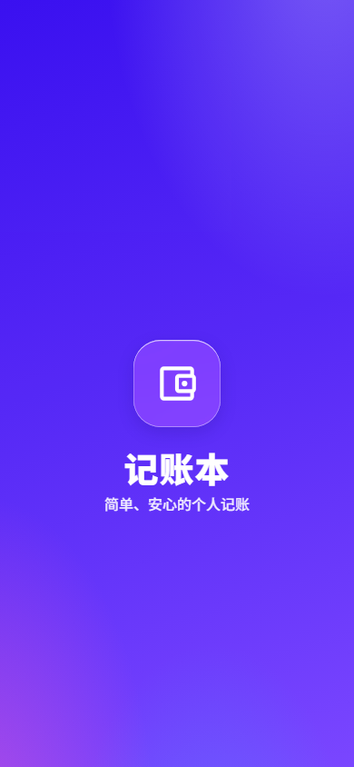
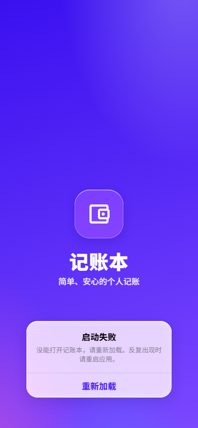
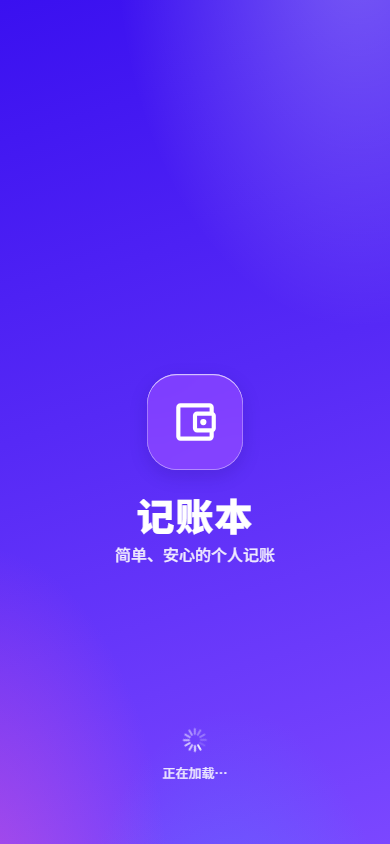
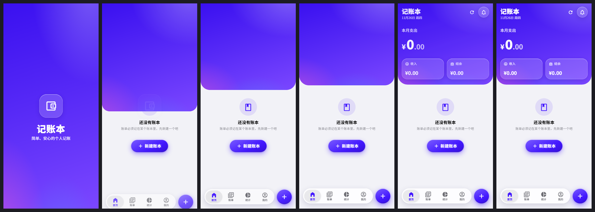
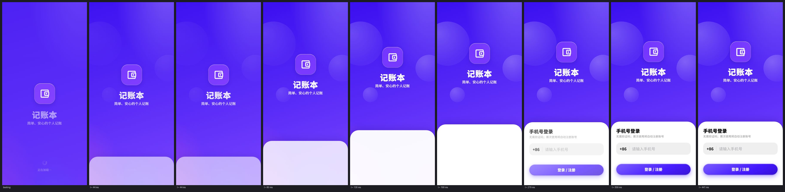
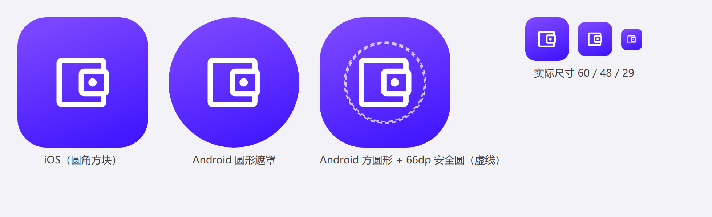

# 冷启动实现记录

设计稿：`docs/design/cold-start/`（01 总览 / 02 各状态 / 03 规格，源文件在本目录的 `*.html`）。
决策与取舍写在 `docs/adr/0007-ios-visual-system.md` §25；这里记「做了什么、怎么验证、还有什么没验证」。

评审时用户确认的方向：交接 = 幕布收拢成首页 Hero（约 400 ms）；应用图标一起换成紫色 Logo 方块；做启动失败兜底卡片；先拆成小步骤再实现。

## 链路

系统启动画面（纯色底 + 扁平 Logo 方块）→ 加载页（同一底色上淡入渐变 + Logo 组）→ 首页 Hero / 登录页。
整条链路是同一张画布：底色、Logo 的位置与大小全程不变，每一步只多长出一层内容。

| 系统启动画面 vs 加载页首帧 | 加载页首帧 |
|---|---|
|  |  |

## 改动清单

| 层 | 文件 | 内容 |
|---|---|---|
| 令牌 | `src/FinanceTracker.Web/wwwroot/css/tokens.css` | 新增 `--ft-splash-bg`（`#5C2EF7`）、`--ft-splash-tile`（`#7E3EFF`） |
| 样式 | `wwwroot/css/boot.css`（新） | 加载页、三种交接、转圈、失败卡片、减弱动态效果 / 降低透明度分支 |
| 脚本 | `wwwroot/js/boot.js`（新） | 状态机（就绪判定、交接、转圈、看门狗）、CDN 资源在 `load` 之后注入、`FtBoot.chartsReady()` |
| 组件 | `Components/StartupHost.razor`（新）、`Main.razor` | 「外壳就绪」信号 |
| 组件 | `Pages/Index.razor`、`Pages/LoginPage.razor` | 根节点声明 `data-ft-ready="home|login"` |
| 组件 | `Components/Ui/EChartsView.razor`（新）+ 5 处 `<MECharts>` 替换 | 图表先等 `FtBoot.chartsReady()`（见下「额外的改动」） |
| 宿主 | `server/FinanceTracker.Web.Server/Pages/_Layout.cshtml`、`src/FinanceTracker.App/wwwroot/index.html` | 加载页标记（`#app` 之外）、`<html data-ft-boot>`、`boot.css` 在 `ui.css` 之后、`boot.js` 在 Blazor 之前、CDN 资源移出 `<head>`、删除旧的「正在加载」 |
| 原生 | `Resources/Splash/splash.svg`、`FinanceTracker.App.csproj` | 新启动图（画布 108、方块 96）；`MauiSplashScreen Color="#5C2EF7" BaseSize="108,108"` |
| 原生 | `Resources/AppIcon/appicon.svg` + `appiconfg.svg`（新）、删除 `appicon.png`、csproj 的 `MauiIcon` | 应用图标换成同一个 Logo（渐变背景层 + 白色钱包前景层） |
| 原生 | `MainPage.xaml` | `BackgroundColor="#5C2EF7"`（WebView 画出来之前露出的就是它） |
| 原生 | `Platforms/Android/MainActivity.cs`、`Platforms/Android/Resources/values/styles.xml` | 启动主题 `Ft.SplashTheme`（继承 `Maui.SplashTheme`，状态栏图标白色） |
| 原生 | `Platforms/iOS/Info.plist` | `UIStatusBarStyle = UIStatusBarStyleLightContent` |
| 测试 | `tests/e2e/boot_test.py`（新）、`e2e_base.py`、`README.md` | 58 项 E2E；基座的 `wait_circuit_ready` 等到加载页收走且 CDN 资源尘埃落定 |
| 测试 | `tests/unit/.../Services/DesignTokensTests.cs` | 9 项新单元测试 + `boot.css` 加入「不用 iOS 14 不支持的特性」的清单 |

## 与设计稿不同、或设计稿没有写明的地方

1. **新增两个令牌**（`--ft-splash-bg` / `--ft-splash-tile`）：系统启动画面不能做渐变与模糊，方块只能是实色；取值是深色玻璃压在渐变上的实测色。
2. **启动图画布 108、方块 96**（四周各留 6）：Android 12+ 的启动图 drawable 由 MAUI 生成、固定拉成 108dp，画布正好 108 才没有尺寸跳变。
3. **多了两处原生改动**：`Ft.SplashTheme`（Android 启动那一刻的状态栏图标是白色）与 iOS 的 `UIStatusBarStyle`；设计稿只要求「状态栏图标从第一帧起就是白色」，这是落地的办法。
4. **删除了 `appicon.png`**（旧图标），换成 SVG 分层图标。
5. **量 Hero 高度用布局位置，不用 `getBoundingClientRect`**：页面栈的 Tab 根页面刚挂上时有 0.985 → 1 的入场缩放，交接恰好发生在缩放途中时会量到缩小后的值，幕布收拢后比 Hero 矮一截。
6. **失败卡片的实现细节**：标记与样式复用 `GlassAlert`（`ft-alert`），与标准 Alert 的差别是没有遮罩、位置在 Logo 组下方；焦点放在容器上（读屏读出 Alert，按钮上不出现焦点环），与 `GlassAlert` 的处理一致。
7. **额外的改动：`EChartsView` 与 `FtBoot.chartsReady()`**——设计稿没有，是把 CDN 资源移到 `load` 之后的必然后果。用户可能在 ECharts 下载完之前就进统计页，
   而 MASA 的 `MECharts` 不检查全局对象就 `echarts.init`，`ReferenceError` 会让整个界面失效（做过探针复现，不是推测）。现在所有图表先等脚本，没到时是骨架，加载失败是说明文字；
   顺带修了「离线时进统计页同样会崩」的老问题。`DesignTokensTests` 扫描所有 `.razor` 防止有人直接写 `<MECharts>`。
8. **30 秒自毁兜底**：加载页自带一个 CSS 动画，30 s 后 `visibility: hidden`——`boot.js` 一直没加载出来也不会永远盖住应用（设计稿只有 12 s 的失败卡片）。
9. **降级时加载页的方块不跟着令牌变色**（收尾时发现的，设计稿写成稿时 23 号 ticket 的材质降级还没落地）：令牌层的三条降级路径（系统降低透明度 / 根开关 `data-ft-solid` / 不支持 `backdrop-filter`）
   会把深色玻璃换成 `#6A42F2`，而启动画面的方块是 `#7E3EFF`；根开关又是宿主在 Blazor 启动之后才写的，加载页还在时就会翻转（探针实测：`rgba(255,255,255,.17)` → `rgb(106, 66, 242)`，每个通道最多差 22）。
   处理：`boot.css` 在三条路径下各有一条覆盖，方块一律回到 `--ft-splash-tile`（翻转前后像素只差 2）；登录交接时再让方块随滑行换成真方块的颜色，滑行结束没有色跳。
   这是对「组件只引用令牌、不为降级写分支」的有意例外，理由写在 ADR §25；`boot_test.py` 的 I 节与单元测试守住。

## 验证结果

- **E2E `tests/e2e/boot_test.py`：58/58**（约 37 s）。覆盖：慢启动（转圈）、失败兜底（卡住 → 恢复；首个请求被拒 → 重新加载）、未登录交接（Logo 终点与真实登录页 Logo 重合 < 0.5 px）、
  已登录交接（幕布高度与 Hero 一致 < 0.6 px）、深链接淡出、慢 CDN（`capMs` 上限）、图表等 ECharts（等待态 → 到了即出图 / 加载失败给说明，应用全程不坏）、减弱动态效果（淡出 100 ms）、
  材质降级下方块不变色（根开关在加载页还在时翻转、系统降低透明度，用实际像素比；宿主判定降级时登录交接的终点）。
  做过变异检查（故意破坏交接终点、故意关掉降级覆盖，对应断言确实会失败）。
- **单元测试**：全量 2023/2023 通过。冷启动新增 9 项：令牌与原生资源取值一致、两个宿主的加载页标记一字不差、`boot.css` 不用 iOS 14 不支持的特性、图表一律经 `EChartsView`（扫描所有 `.razor`）等；都做过变异检查。
- **最终回归**：见下一节。
- **原生资源**：Android 目标构建通过，生成的启动图 / 自适应图标分层 / 各 dpi 尺寸逐项量过（截图见 `screenshots/07`、`08`）；**iOS 没有构建**，真机 / 模拟器上没有点开过。

| 失败兜底卡片 | 超过 0.6 s 出现转圈 |
|---|---|
|  |  |

交接逐帧（0 / 100 / 200 / 300 / 400 ms 附近）：





应用图标（iOS 圆角方块 / Android 圆形遮罩 / 方圆形 + 66dp 安全圆）：



## 最终回归

同一份工作区、最后一轮：

- **全量 E2E 28/28 通过**（含 `boot`、统计 / 趋势年报 / 自定义报表三个图表页、所有页面的「登录 → 首屏」路径）。这一轮在「降级时方块不变色」那处改动**之前**。
- 那处改动之后重跑了直接相关的：`boot` 58/58、`login_page` + `home_page` + `tab_shell` + `blazor_smoke`（共 243 项）、`a11y_degradation` 的 M 节（材质降级，含宿主判定的重载路径）36/36，全部通过；**没有再重跑全量**。
  改动只在 `boot.css` 的降级分支（常态下是空操作），这 6 个脚本已经覆盖了加载页交接的所有路径。
- **单元测试 2023/2023 通过**（改动之后）。

我自己第一轮全量是 22/28，6 个脚本没过。逐个排查后都与冷启动无关，最后全部通过：

| 脚本 | 当时的现象 | 原因 | 结果 |
|---|---|---|---|
| `import`、`ledger_members` | 登录处超时 / 连接被拒 | Web.Server 在我跑的过程中被别的工作重启过 | 重跑通过 |
| `log_viewer`、`profile` | 日志条数 / 待确认角标对不上 | 另一路同时在跑的 E2E 往同一个日志目录和待确认账单表里写数据 | 错开后重跑通过（180/180、97/97） |
| `a11y_degradation` | 十来项失败（Toast 图标过渡、输入光标动画、多选框填充等） | 别的工单的在途改动，没有一项与 `ft-boot` 相关 | 之后的全量里通过 |
| `ledgers_page` | `LedgerMembers` 唯一约束冲突 | 账本成员页进入时会补建所有者行，与脚本里随后手动插入所有者行冲突，和冷启动无关 | 之后的全量里通过 |

## 未验证项与真机验收清单

自动化只覆盖「加载页之后」的 Web 层（Chromium）。下面这些必须在真机 / 模拟器上人工验收：

- [ ] **Android 12+**：点图标 → 紫色底 + 扁平 Logo 方块，没有白闪；方块没有被圆形遮罩裁切；状态栏图标是白色；启动画面 → 加载页首帧**没有一帧色差或跳变**（方块位置 / 大小 / 底色）。
- [ ] **Android 11 及以下**（`windowBackground` 路径）与几家常见厂商 ROM 上同样检查。
- [ ] **iOS**（模拟器 + 真机）：由 `splash.svg` 生成的启动图 → 加载页首帧是否一致；状态栏图标从第一帧起是白色（`UIStatusBarStyle`）。**本次没有构建过 iOS 目标。**
- [ ] **应用图标**：Android 自适应图标（圆形 / 方圆形 / 水滴）与 iOS 圆角蒙版下的观感；删除 `appicon.png` 之后各平台的图标生成没有报错、没有回退到旧图。
- [ ] **已登录冷启动**：幕布收拢成 Hero，中低端 Android 上是否掉帧（`height` + `border-radius` 过渡，只在 `position: fixed` 的加载页里，但没有在低端机上测过）。
- [ ] **未登录冷启动**：Logo 滑到登录页 Logo 的位置、面板升起。
- [ ] **飞行模式启动**：图标字体缺失、应用照常启动；进统计页图表位置显示「图表组件未能加载……」，界面不崩。
- [ ] **慢网启动**：首屏不被 CDN 拖住；联网恢复后重新打开应用图标与图表正常。
- [ ] **系统「减弱动态效果」**（Android「移除动画」/ iOS「减弱动态效果」）：交接换成约 100 ms 淡出。
- [ ] **MAUI WebView 里的 `load` 时点**：确认 CDN 资源移到 `load` 之后确实让 Blazor 更早启动（Chromium 里只验证过「CDN 被拖慢时加载页照常出现、应用照常启动」）。
- [ ] **标定三个时间常量**：`spinnerMs` 600 / `capMs` 1500 / `watchdogMs` 12000 都是建议值。量法：`adb shell am start -W` 看冷启动耗时；Chrome 远程调试（`chrome://inspect`）里读 `FtBoot.state` 变化的时间点；
  量过「点图标 → 外壳就绪」的分布（尤其低端机）再调；失败卡片在真机上很难自然触发，要看样子可以临时把 `watchdogMs` 改小（宿主页在 `boot.js` 之前设置 `window.FT_BOOT_TIMINGS`）。
- [ ] CDN **连得上却一直不返回**（挂起）时，统计页图表位置会一直是骨架，直到浏览器自己判定超时——只验证过「脚本加载失败」与「脚本很晚才到」。

## 复跑

```powershell
# Web 层 E2E（要求 Web.Server 已启动：powershell -NoProfile -ExecutionPolicy Bypass -File tests/e2e/server.ps1 -Action start）
python tests/e2e/boot_test.py

# 单元测试（令牌 / 原生资源 / 宿主页一致性）
dotnet test tests/unit/FinanceTracker.Tests/FinanceTracker.Tests.csproj --filter "FullyQualifiedName~DesignTokensTests"

# 原生资源（Android；iOS 目标需要 macOS 构建主机）
dotnet build src/FinanceTracker.App/FinanceTracker.App.csproj -f net10.0-android
```

`tests/e2e/server.ps1` 的输出不要接管道（会让 shell 挂住），需要时重定向到文件。

## 过程中踩到的坑（已解决，留作参考）

- 度量交接动画时不要等「全部动画结束」：加载页有 30 s 的自毁动画和一个无限转圈，应当只等 `CSSTransition`。
- 「卡住后恢复」与「首个请求失败后重载」是两个不同的场景：前者只是慢（卡片应自动撤掉），后者才需要「重新加载」按钮——测试里各用一套路由，别混用。
- Playwright 里留着没有处理的 `route` 在关闭上下文时会打出一长串 `CancelledError`，测试结束前要把挂起的路由放行或不要挂起。
- XML 注释里不能出现 `--`（`styles.xml` 的 MSB4025）。
- PowerShell 5.1 的 `Set-Content -Encoding UTF8` 会给文件加 BOM——临时改文件做变异检查后，还原要用字节写回（`MainPage.xaml` 差点因此多出一个 BOM）。
- E2E 脚本共用同一个 Web.Server、同一个本地库和同一个日志目录，两路同时跑会互相干扰；回归失败先排除这种情况再看代码。
  判断「还有没有别的 E2E 在跑」要找 `python3.13.exe`（Windows 应用商店版 Python 的进程名），按 `python.exe` 找会漏掉。

## 工作区里与冷启动无关的发现

- 工作区里同时有别的工单在改（`ui.css`、`a11y_degradation`、账本成员页等），中途出现过的、不属于冷启动的失败，最后一轮都已消失；冷启动只改了本文「改动清单」里的文件。
